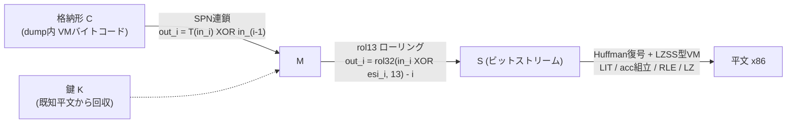

# toka(藤花) — KONNパッカーフォーマットの解析ツールキット

**KONN形式**(作業名)は、記述子署名`0x4E4E4F4B`(LEバイト列`4B 4F 4E 4E` = `"KONN"`)で識別される、自己復号パッカーとバイトコードVMで保護されたx86-64イメージの形式です。**toka**はその解析に必要なアルゴリズム群のPython実装です。コアは純Python(標準ライブラリのみ)で動作し、NumPy / capstone / unicornは導入時のみ有効になる任意依存です。同梱のSAMPLEプロファイルは合成レイアウトであり、対象固有の配置はユーザー定義のプロファイルで与えます。

## 位置づけ

「自己復号パッカー + バイトコードVM」は、正当なソフトウェアの保護(サイズ削減・リバース防止)とマルウェアの隠蔽の両方に使われる構成です。アンチウイルス、サンドボックス、メモリフォレンジックはいずれも「格納形を静的に平文へ展開する」解析器を必要とします。

tokaはその種の解析器の、形式仕様に忠実な純Python実装です:

- **静的・オフライン・非実行** — 入力はダンプ/ファイルのみ。保護機構の無効化・パッチ・実行時のバイパスは一切行わない
- **可逆性の検証** — すべての復号を可逆変換として実装し、roundtripテスト(暗号化→復号の往復)で検証
- **不確実性の台帳** — 解析からの再構成に依存する箇所は「実データ突合チェックリスト」に明示(下記)

## KONN形式の構造不変量

形式の識別と解析に必要な不変量(すべて本パッケージの実装由来。対象イメージのメモリ配置などの実測値は含まない):

- **Stage0 — パック済み形式(自己復号パッカー)**
  - 記述子: 8×i32、署名`0x4E4E4F4B`、stride `0x20`
  - ローリングキー復号: `key0 = (~size + initKey) & 0xffffffff`、`plain_i = key_i ^ chunk_i`、`key_{i+1} = i^2 ^ (chunk_i + i + key_i)`(可逆・roundtrip検証可)
- **Stage1 — 復号済みコード領域**(領域とOEPはプロファイルで指定)
- **Stage2 — バイトコードVM**: 格納形ブロックを3段パイプラインで平文x86へ展開(次節)

## Stage2 — 3段パイプライン



- **SPN連鎖**: 16バイトブロック。`T()`はダンプ内の鍵素材(ラウンド数`word[key+2]>>1`、ラウンド鍵、S-box 4枚)でデータ駆動。`t_func`引数で差し替え可能
- **rol13**: dwordローリング。`esi_i = K + i*(i-1)/2`。端数バイトは無処理
- **VM**: 3バイト/エントリのHuffman表(ルート256)で1命令ずつフェッチし、LIT / acc組立 / RLE / LZの4モードで平文を組立出力

## インストール

```bash
pip install pytoka        # PyPI(配布名。import名は toka)

# ソースから
git clone https://github.com/sh-sunfaded/Toka.git
cd Toka
pip install .            # コアのみ(標準ライブラリのみで動作)
pip install .[fast]      # + NumPy 高速パス
pip install .[emu]       # + Stage1 エミュレーション(unicorn)
pip install .[disasm]    # + 命令デコード(capstone)
```

ソースツリーを直接使う場合は`PYTHONPATH=.`でも動作します。

## モジュール構成

| モジュール | 機能 |
| --- | --- |
| `toka/ciphers.py` | SPN連鎖 + rol13(正逆・鍵導出式) |
| `toka/vmcode.py` | Huffman表(復号・符号再構築・構築) + LZSS型展開 + 先頭列挙DFS |
| `toka/pipeline.py` | 3段統合 + 既知平文ブートストラップ鍵回収(段階的棄却) |
| `toka/fastpath.py` | 任意依存(NumPy)のベクトル化高速パス |
| `toka/config.py` | 対象別プロファイル(鍵素材・表・閾値の集約。同梱SAMPLEは合成レイアウト) |
| `toka/mailslot.py` | mailslotメッセージ復号 + k0範囲走査 |
| `toka/unpack.py` | 自己復号パッカー(Stage0→Stage1): 記述子走査・ローリングキー・Unicorn実行 |
| `toka/disasm.py` | movabs隠蔽コード検出・jmp-over-jmp・再帰下降disasm |
| `toka/cli.py` | コマンドライン(`toka`コマンド / `python -m toka.cli`) |

## CLI使用例

```bash
# バージョン確認
toka --version

# VMブロックを3段で展開(鍵はプロファイル値)
toka decrypt-block dump.bin --desc 0x1000:0x40:0x1000:0x80 --out ref.bin

# 既知平文から rol13 鍵 K を回収
toka recover-key dump.bin --desc 0x1000:0x40:0x1000:0x80 --ref ref.bin

# mailslot暗号ボディ復号(k0自動走査)
toka mailslot body.bin --out plain.txt

# movabs即値に隠された実コードの検出
toka find-movabs code.bin --base 0x1400b000

# Stage1記述子走査
toka stage0 packed.bin
```

(`python -m toka.cli`でも同一インターフェース)

上流ツール連携: izayoiの`pairs`が出力する記述子`off1:size1:off2:size2`はそのまま`--desc`に渡せます。

## 入力形式

- VMブロックの入力ダンプは**RVA==ファイルオフセット**形式を想定
- 一部の採取ツールが先頭に付けるテキストヘッダ(例: `REGION ... addr=... size=...` + 改行)は`load_image`が自動除去する

## Python API

```python
from toka import Descriptor, Pipeline, load_image
from toka.config import PROFILES

profile = next(iter(PROFILES.values()))  # 同梱の合成サンプルプロファイル
pipe = Pipeline(profile, load_image("dump.bin"))
plain = pipe.decrypt_block(Descriptor.parse("0x1000:0x40:0x1000:0x80"))
# 鍵が未知の対象は既知平文から回収
k = pipe.recover_key(desc, known_expanded_block)
```

## パフォーマンス(任意依存)

NumPyが導入されている環境では、ホットパスが自動的にベクトル化実装(`toka/fastpath.py`)に切り替わります。導入していなくても結果は同一です(フォールバックは純Python実装):

- **rol13 fwd/inv** — 鍵ストリーム`esi_i = K + i*(i-1)/2`の閉形式を使いデータ全体を一括処理
- **SPN連鎖** — `T(in_i)`は全ブロック独立なのでブロック一括処理 + 隣接XOR(`out[1:] ^= in[:-1]`)で逐次ループを排除
- **mailslot k0範囲走査** — 候補軸で一括フィルタ(chunked)
- **ブートストラップ鍵回収** — 候補×先頭ウィンドウの一括計算

ベクトル化しない層(逐次依存が本質的なため):

- Stage0ローリングキー復号(鍵更新に加算キャリーが絡む逐次再帰)
- Huffman/LZSS展開(ビット毎の状態機械)

鍵回収(`recover_rol13_key`)は、NumPyの有無に関わらず**段階的棄却**で最適化されています。各候補について全ストリームを検証する前に、先頭ウィンドウ(既定8 dword)だけの展開で既知平文と矛盾する候補を即棄却します(ゴミ候補の大半は最初の数シンボルで落ちる)。単純全数検証の実装(`_recover_naive`)も等価性テスト用に同梱しています。

## 新規プロファイルの追加手順

1. ダンプ(RVA==オフセット形式。`load_image`は採取ツール独自のヘッダを自動除去)を用意し、VMブロック記述子`{off1,size1,off2,size2}`を特定する
2. `key_pair`の分岐閾値、SPN鍵素材/Huffman表のRVAとサイズ、S-boxのRVAを調査し`GameConfig`を1つ定義して`PROFILES`に登録する(同梱の合成SAMPLEプロファイルがテンプレートになる)
3. `recover-key`で鍵を回収し、プロファイルの`rol13_key`に書き戻す
4. 同一構造ならciphers/vmcode/pipelineは無変更で動作する

## 実データ突合チェックリスト(不確実性台帳)

本ツールキットのうち、解析からの再構成であり実データとの突合が必須の項目です。検証の基準手順: **既知の格納形ブロックを`decrypt-block`し、既知の展開結果とバイト完全一致すること**。

1. **SPN T()のラウンド内演算順** — `_default_t`はラウンド内の演算順を想定して組み直した参考実装。不一致なら`SPN(..., t_func=)`で差し替える(連鎖式自体は確定済み)
2. **Huffman byte+2(extra)の意味** — 降下後の葉では消費しない解釈を採用。一致しない場合は`decode_symbol`の葉側`consume`を調整する
3. **accの最大2バイト解釈** — acc>=0x100で組立失敗とする解釈。対象ブロックの展開が途中で拒否される場合はこの条件を再検討する
4. **mailslotのi更新タイミング** — 処理後に`k = ror32(k+i, 7)`で固定。既知平文が1バイトずれる場合は`decode_body`のiを調整する
5. **Stage0のsize/initKey** — `decrypt_stream`は`key0 = (~size + initKey)`で導出。記述子の実測フィールドからsize・initKeyを正しく取ること(roundtripで検証)

## 関連ツール

同じメモリフォレンジックの流れで併用できる姉妹ツール:

- [izayoi](https://github.com/sh-sunfaded/izayoi) — 複数時点ダンプの比較・トリアージ。`pairs`が出力する記述子`off1:size1:off2:size2`は本ツールの`--desc`にそのまま渡せる
- [Sekka](https://github.com/sh-sunfaded/Sekka) — x64 PE例外テーブル(.pdata)の静的解析。展開後の平文イメージから関数境界・例外ハンドラを引ける

## 制限

- 同梱のSAMPLEプロファイルは合成レイアウト(実測値を含まない)。対象固有の配置はユーザー定義プロファイルで与える
- SPN `T()`のラウンド内演算順など、解析からの再構成に依存する箇所は実データ突合チェックリストの検証が前提
- Stage1のエミュレーション(unicorn)と命令デコード(capstone)は任意依存。未導入でもStage0 / Stage2は動作する
- 対象はx86-64イメージ

## テスト

```bash
python3 tests/test_toka.py    # 33チェック・合成データのみ・外部ダンプ不要
```

NumPyが導入された環境では、ベクトル化実装と純Python実装の等価性検証(rol13 / SPN連鎖 / k0走査 / 段階的鍵回収)も自動実行されます。未導入の環境ではこれらのテストはスキップされ、残りはすべて通ります。

実データを使う検証(上記チェックリスト)は、格納形と展開結果の既知の対が手元にある際に`decrypt-block` / `stage0`の各サブコマンドで行います。
