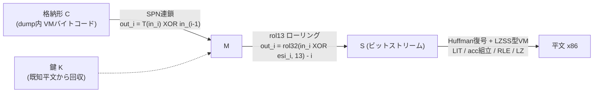

# drmvm — DMMゲームDRM仮想マシン解析ツールキット

学マス DMM版（gakumas.exe）のDRM逆解析（NixOS + Wine 11.21、第1〜60次）で
確立した解読技法を、同一保護（PCR/ウマ娘系）へ転用可能な形に一般化した
純Python（標準ライブラリのみ）パッケージ。capstone / unicorn は
導入時のみ有効になる任意依存。

## 3段パイプライン



- **SPN連鎖**: 16バイトブロック、`T()` はダンプ内の鍵素材（ラウンド数
  `word[key+2]>>1`、ラウンド鍵、S-box 4枚）でデータ駆動。`t_func` 引数で差し替え可能。
- **rol13**: dwordローリング。`esi_i = K + i*(i-1)/2`。端数バイトは無処理。
- **VM**: 3バイト/エントリのHuffman表（ルート256）で1命令ずつフェッチし、
  LIT/acc組立/RLE/LZ の4モードで平文を組立出力。

## モジュール構成

| モジュール | 機能 | 対応する実績資産 |
| --- | --- | --- |
| `drmvm/ciphers.py` | SPN連鎖 + rol13（正逆・鍵導出式） | rol13/SPN解析（第57〜58次） |
| `drmvm/vmcode.py` | Huffman表（復号・符号再構築・構築）+ LZSS展開 + 先頭列挙 | vm.py / huffenc.py（フェーズAF/AH） |
| `drmvm/pipeline.py` | 3段統合 + 既知平文ブートストラップ鍵回収 | 第58次AH開発 |
| `drmvm/config.py` | ゲーム別プロファイル（鍵素材・表・閾値の集約） | dump実測値 |
| `drmvm/mailslot.py` | mailslot報告ボディ復号 + k0範囲走査 | decode_body.py（フェーズQ） |
| `drmvm/unpack.py` | Stage1パッカー記述子走査・ローリングキー・Unicorn実行 | フェーズE〜K |
| `drmvm/disasm.py` | movabs隠蔽コード検出・jmp-over-jmp・再帰下降disasm | 手動解析（フェーズAC/S/第40次） |
| `drmvm/patches.py` | Patch-L 33箇所走査/leaフィルタ + Patch-G + 適用検証 | verify_patches.py / poll-and-patch（第59/60次） |
| `drmvm/cli.py` | コマンドライン（`python -m drmvm.cli`） | — |

## CLI 使用例

```bash
# VMブロックを3段で展開（鍵はプロファイル値）
python -m drmvm.cli decrypt-block dump1.bin --desc 0xb39ec:0xc12:0xb39ec:0x14bc --out ref.bin

# 既知平文（v1d相当）から rol13 鍵 K を回収
python -m drmvm.cli recover-key dump1.bin --desc 0xb39ec:0xc12:0xb39ec:0x14bc --ref v1d_block.bin

# mailslot暗号ボディ復号（k0自動走査）
python -m drmvm.cli mailslot body.bin --out plain.txt

# Patch-L候補走査 + Patch-G適用状態検証
python -m drmvm.cli scan-patches dump1.bin

# movabs即値に隠された実コードの検出
python -m drmvm.cli find-movabs code.bin --base 0x1400b000

# Stage1記述子走査
python -m drmvm.cli stage0 packed.bin
```

## Python API

```python
from drmvm import Descriptor, Pipeline, load_image
from drmvm.config import GAKUMAS

pipe = Pipeline(GAKUMAS, load_image("dump1.bin"))
plain = pipe.decrypt_block(Descriptor.parse("0xb39ec:0xc12:0xb39ec:0x14bc"))
# 鍵が未知のタイトルは既知平文から回収
k = pipe.recover_key(desc, known_expanded_block)
```

## 新規ゲームプロファイルの追加手順

1. ダンプ（RVA==オフセット形式、`load_image` は GKM_DUMP ヘッダを自動除去）
   を用意し、VMブロック記述子 `{off1,size1,off2,size2}` を特定する。
2. `key_pair` の分岐閾値、SPN鍵素材/Huffman表のRVAとサイズ、S-box のRVA、
   mailslot名を調査し `GameConfig` を1つ定義して `PROFILES` に登録する。
   （学マス実測値が `GAKUMAS` のテンプレートになる）
3. `recover-key` で鍵を回収 → プロファイルの `rol13_key` に書き戻す。
4. 同一保護なら ciphers/vmcode/pipeline は無変更で動作する。

## 実機検証チェックリスト（不確実性台帳）

本ツールキットのうち、ダンプ解析からの再構成であり実機突合が必須の項目。
検証の基準手順: **dump1[0xb39ec:+0xc12] を `decrypt-block` し、
v1d（280ログ時点の展開形）とバイト完全一致すること**。

1. **SPN T() のラウンド内演算順** — `_default_t` は解析メモからの再構成。
   不一致なら `SPN(..., t_func=)` で差し替える（連鎖式自体は確定済み）。
2. **Huffman byte+2（extra）の意味** — 降下後の葉では消費しない解釈を採用。
   一致しない場合は `decode_symbol` の葉側 `consume` を調整する。
3. **acc の最大2バイト解釈** — acc>=0x100 で組立失敗とする解釈。
   idx13ブロックの展開が途中で拒否される場合はこの条件を再検討。
4. **mailslot の i 更新タイミング** — 処理後に `k = ror32(k+i, 7)` で固定。
   実測ボディの先頭既知平文（`-- Version\r\n`）が1バイトずれる場合は
   `decode_body` の i を調整。
5. **Stage0 の size/initKey** — `decrypt_stream` は
   `key0 = (~size + initKey)` で導出。記述子の実測フィールドから
   size・initKey を正しく取ること（roundtrip で検証）。

## テスト

```bash
python3 tests/test_drmvm.py    # 約40チェック・外部データ不要・数秒で完了
```

実データを使う検証（上記チェックリスト）は、実ダンプ入手時に
`decrypt-block` / `scan-patches` / `stage0` の各サブコマンドで行う。
