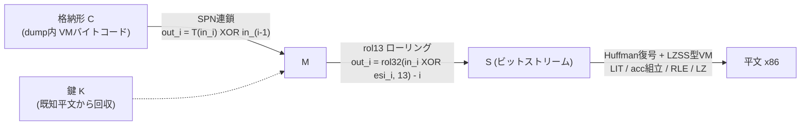

# 藤花(Toka) — 仮想マシン形式の解析ツールキット

パックされたx86イメージ内部で動作する独自の仮想マシン形式の解析で
確立した解読技法を、特定の製品に依存しない形に一般化したパッケージ。
コアは純Python（標準ライブラリのみ）で動作し、NumPy / capstone /
unicorn は導入時のみ有効になる任意依存。研究・学習用途を想定。

## 3段パイプライン



- **SPN連鎖**: 16バイトブロック、`T()` はダンプ内の鍵素材（ラウンド数
  `word[key+2]>>1`、ラウンド鍵、S-box 4枚）でデータ駆動。`t_func` 引数で差し替え可能。
- **rol13**: dwordローリング。`esi_i = K + i*(i-1)/2`。端数バイトは無処理。
- **VM**: 3バイト/エントリのHuffman表（ルート256）で1命令ずつフェッチし、
  LIT/acc組立/RLE/LZ の4モードで平文を組立出力。

## インストール

```bash
git clone https://github.com/sh-sunfaded/Toka.git
cd Toka
pip install .            # コアのみ（標準ライブラリのみで動作）
pip install .[fast]      # + NumPy 高速パス
pip install .[emu]       # + Stage1 エミュレーション (unicorn)
pip install .[disasm]    # + 命令デコード (capstone)
```

Git からではなくソースツリーを直接使う場合は `PYTHONPATH=.` でも動作する。
## モジュール構成

| モジュール | 機能 |
| --- | --- |
| `toka/ciphers.py` | SPN連鎖 + rol13（正逆・鍵導出式） |
| `toka/vmcode.py` | Huffman表（復号・符号再構築・構築）+ LZSS型展開 + 先頭列挙DFS |
| `toka/pipeline.py` | 3段統合 + 既知平文ブートストラップ鍵回収（段階的棄却） |
| `toka/fastpath.py` | 任意依存 (NumPy) のベクトル化高速パス |
| `toka/config.py` | 対象別プロファイル（鍵素材・表・閾値の集約） |
| `toka/mailslot.py` | mailslotメッセージ復号 + k0範囲走査 |
| `toka/unpack.py` | Stage1パッカー記述子走査・ローリングキー・Unicorn実行 |
| `toka/disasm.py` | movabs隠蔽コード検出・jmp-over-jmp・再帰下降disasm |
| `toka/patches.py` | 既知バイトパターンの走査と検証（leaフィルタ付き） |
| `toka/cli.py` | コマンドライン（`python -m toka.cli`） |

## CLI 使用例

```bash
# VMブロックを3段で展開（鍵はプロファイル値）
python -m toka.cli decrypt-block dump1.bin --desc 0xb39ec:0xc12:0xb39ec:0x14bc --out ref.bin

# 既知平文から rol13 鍵 K を回収
python -m toka.cli recover-key dump1.bin --desc 0xb39ec:0xc12:0xb39ec:0x14bc --ref ref.bin

# mailslot暗号ボディ復号（k0自動走査）
python -m toka.cli mailslot body.bin --out plain.txt

# 既知バイトパターンの走査と検証
python -m toka.cli scan-patches dump1.bin

# movabs即値に隠された実コードの検出
python -m toka.cli find-movabs code.bin --base 0x1400b000

# Stage1記述子走査
python -m toka.cli stage0 packed.bin
```

## Python API

```python
from toka import Descriptor, Pipeline, load_image
from toka.config import PROFILES

profile = next(iter(PROFILES.values()))  # 同梱のサンプルプロファイル
pipe = Pipeline(profile, load_image("dump1.bin"))
plain = pipe.decrypt_block(Descriptor.parse("0xb39ec:0xc12:0xb39ec:0x14bc"))
# 鍵が未知の対象は既知平文から回収
k = pipe.recover_key(desc, known_expanded_block)
```

## パフォーマンス（任意依存）

NumPy が導入されている環境では、ホットパスが自動的にベクトル化実装
（`toka/fastpath.py`）に切り替わる。導入していなくても結果は同一
（フォールバックは純Python実装）:

- **rol13 fwd/inv** — 鍵ストリーム `esi_i = K + i*(i-1)/2` の閉形式を
  使いデータ全体を一括処理。
- **SPN連鎖** — `T(in_i)` は全ブロック独立なのでブロック一括処理 +
  隣接XOR (`out[1:] ^= in[:-1]`) で逐次ループを排除。
- **mailslot k0範囲走査** — 候補軸で一括フィルタ（chunked）。
- **ブートストラップ鍵回収** — 候補×先頭ウィンドウの一括計算。

ベクトル化しない層（逐次依存が本質的なため）:

- Stage0 ローリングキー復号（鍵更新に加算キャリーが絡む逐次再帰）
- Huffman/LZSS 展開（ビット毎の状態機械）

また鍵回収 (`recover_rol13_key`) は、NumPy の有無に関わらず
**段階的棄却**で最適化されている: 各候補について全ストリームを
検証する前に、先頭ウィンドウ（既定8 dword）だけの展開で既知平文と
矛盾する候補を即棄却する（ゴミ候補の大半は最初の数シンボルで落ちる）。
単純全数検証の実装（`_recover_naive`）も等価性テスト用に同梱。

## 新規プロファイルの追加手順

1. ダンプ（RVA==オフセット形式、`load_image` は採取ツール独自の
   ヘッダを自動除去）を用意し、VMブロック記述子 `{off1,size1,off2,size2}` を特定する。
2. `key_pair` の分岐閾値、SPN鍵素材/Huffman表のRVAとサイズ、S-box のRVAを
   調査し `GameConfig` を1つ定義して `PROFILES` に登録する。
   （同梱プロファイルがテンプレートになる）
3. `recover-key` で鍵を回収 → プロファイルの `rol13_key` に書き戻す。
4. 同一構造なら ciphers/vmcode/pipeline は無変更で動作する。

## 実機検証チェックリスト（不確実性台帳）

本ツールキットのうち、ダンプ解析からの再構成であり実機突合が必須の項目。
検証の基準手順: **dump1[0xb39ec:+0xc12] を `decrypt-block` し、
既知の展開結果とバイト完全一致すること**。

1. **SPN T() のラウンド内演算順** — `_default_t` は解析メモからの再構成。
   不一致なら `SPN(..., t_func=)` で差し替える（連鎖式自体は確定済み）。
2. **Huffman byte+2（extra）の意味** — 降下後の葉では消費しない解釈を採用。
   一致しない場合は `decode_symbol` の葉側 `consume` を調整する。
3. **acc の最大2バイト解釈** — acc>=0x100 で組立失敗とする解釈。
   idx13ブロックの展開が途中で拒否される場合はこの条件を再検討。
4. **mailslot の i 更新タイミング** — 処理後に `k = ror32(k+i, 7)` で固定。
   実測ボディの先頭既知平文（`-- Version\r\n`）が1バイトずれる場合は
   `decode_body` の i を調整。
5. **Stage0 の size/initKey** — `decrypt_stream` は
   `key0 = (~size + initKey)` で導出。記述子の実測フィールドから
   size・initKey を正しく取ること（roundtrip で検証）。

## テスト

```bash
python3 tests/test_toka.py    # 33チェック・合成データのみ・外部ダンプ不要
```

NumPy が導入された環境では、ベクトル化実装と純Python実装の
等価性検証（rol13 / SPN連鎖 / k0走査 / 段階的鍵回収）も自動実行される。
未導入の環境ではこれらのテストはスキップされ、残りはすべて通る。

実データを使う検証（上記チェックリスト）は、実ダンプ入手時に
`decrypt-block` / `scan-patches` / `stage0` の各サブコマンドで行う。
